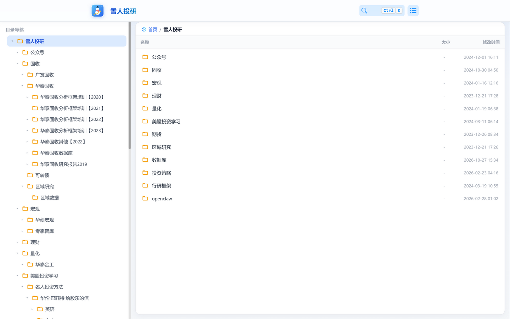
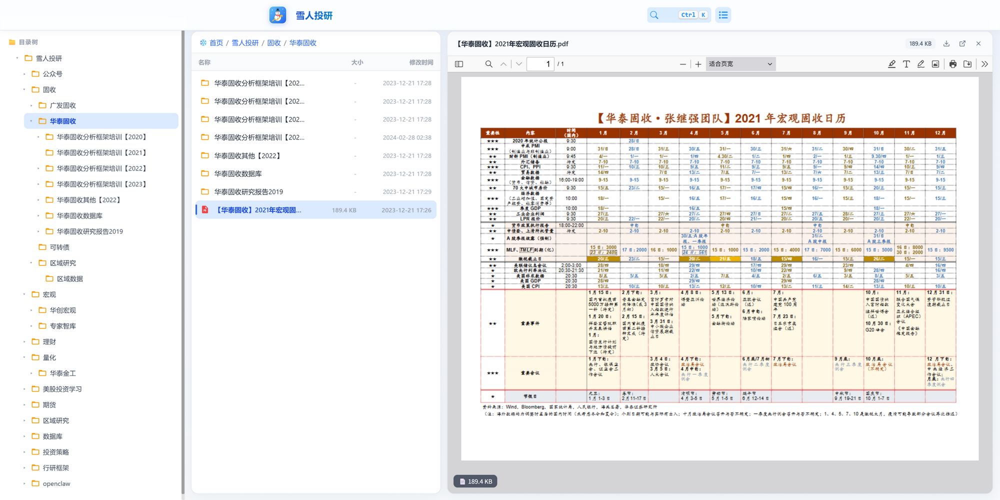
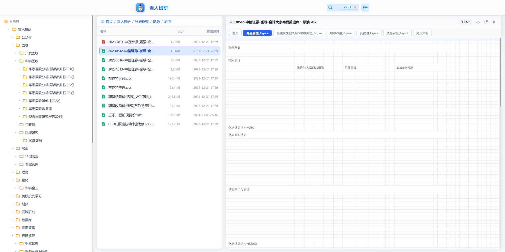
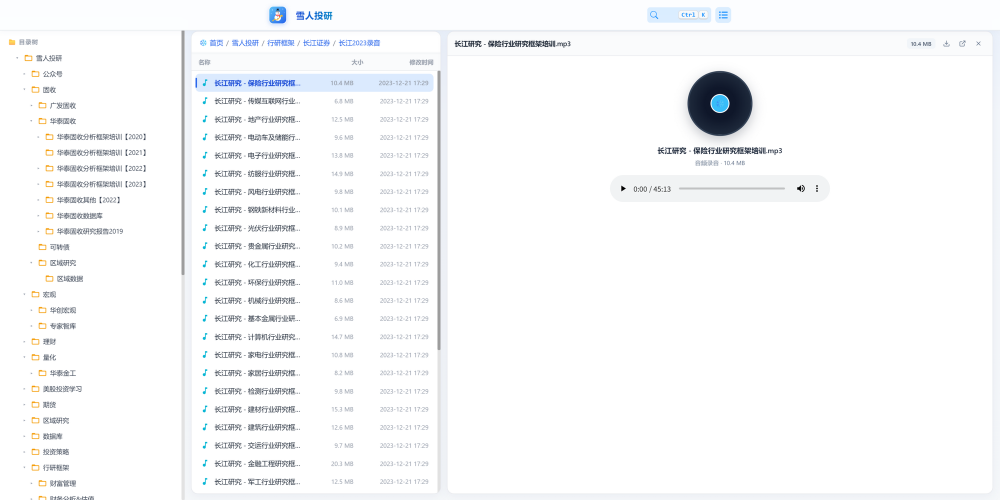
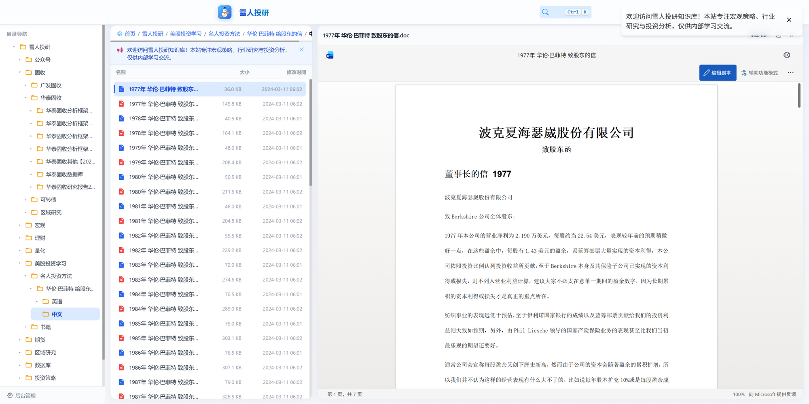
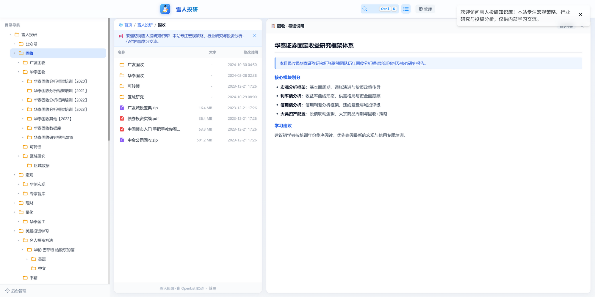
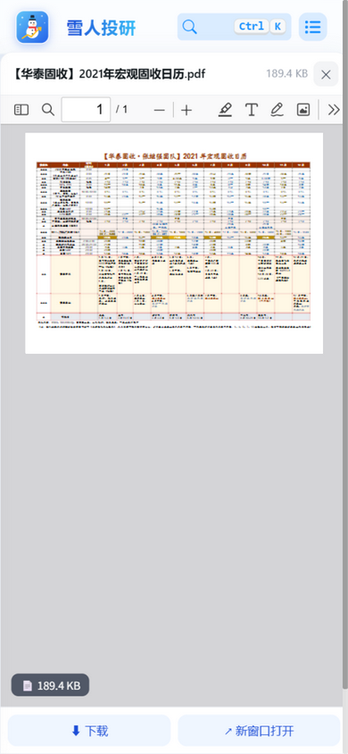

# ❄️ OpenList / AList Workbench Theme

<p align="center">
  
</p>

<p align="center">
  <strong>专为投研知识库、技术文档站与团队网盘打造的现代 IDE 级三栏工作台皮肤</strong><br>
  <em>A Modern Three-Column Productivity Workbench Theme for OpenList & AList</em>
</p>

<p align="center">
  <a href="LICENSE"></a>
  <a href="https://github.com/mercer08/openlist-theme-workbench/actions/workflows/validate.yml"></a>
  <a href="https://github.com/OpenListTeam/OpenList"></a>
  <a href="https://github.com/alist-org/alist"></a>
  
</p>

> **本仓库是 fork**：衍生自 [Nickszy/openlist-theme-workbench](https://github.com/Nickszy/openlist-theme-workbench)，在上游基础上做了少量本地化改造（品牌名、PDF 预览回退、Excel 加载校验），差异与升级方式见 [FORK.md](FORK.md)。
> 原始设计与实现的版权归上游作者所有，同样以 MIT 许可发布。

---

## 💡 为什么要做这个皮肤？（设计思考与痛点）

在搭建个人投研知识库（1400+ 篇研报、财务模型与培训录音）时，我们发现原生网盘界面在实际桌面生产力场景下存在几个明显的体验瓶颈：

1. **大屏空间利用率低**：原生界面通常将内容局限在居中的狭窄区域（约 980px），在 1080p、2K 甚至宽屏显示器上，屏幕两侧留有大量无意义的空白；
2. **目录切换整页白屏闪烁**：原生路由机制下，每次点击文件夹都伴随整页重绘，对于需要高频跨分类翻阅研报的场景，体验十分割裂；
3. **预览体验割裂且依赖外部脆弱服务**：默认配置将 Excel、Word 依赖微软或谷歌的公网云预览服务，国内访问缓慢且易超时，且私密网盘往往因为鉴权拦截导致无法获取文件；
4. **长目录名频繁截断**：深度研报路径（例如《华泰证券宏观固收框架培训【2023】》）在固定宽度的侧栏中往往被截断为省略号，无法快速辨识。

### 🎨 我们的设计思路

我们借鉴了 **VS Code / Notion / macOS Finder / 飞书网盘** 的桌面级工作台架构：
- **左侧**：可鼠标自由拖拽宽度的目录树（180px ~ 580px），长标题不截断，会话级状态持久化，切换时秒开无白屏；
- **中间**：规整紧凑的文件列表卡片，具备严谨表头（`名称`、`大小`、`修改时间`）与单行平滑滚动面包屑，点击目录仅局部无缝重绘，**页面零刷新**；
- **右侧**：**完全独立的视口级满高大屏预览区**（高度拉满至屏幕底端），内置离线自托管预览引擎，带来沉浸式查阅体验。

---

## ✨ 核心特性

- 🖥️ **现代三栏工作台架构**：左目录树 + 中文件列表 + 右侧满高预览，自适应 2K 宽屏与常规笔记本屏幕；
- ↔️ **侧边栏自由拖拽定宽**：自带边缘拖拽手柄，宽度实时调整并自动持久化到 `localStorage`，刷新页面依然保持你的习惯宽度；
- ⚡ **无刷新流畅切换**：状态持久化到 `sessionStorage`，切换目录仅局部重载文件列表，告别网页跳转白屏闪烁；
- 📄 **大屏满高 PDF 研报阅读**：自托管最新 PDF.js，默认按页宽 100% 撑满，自带真实下载进度条与文件体积角标，高度顶天立地；
- 📊 **离线交互式 Excel 表格**：自托管 SheetJS 纯本地毫秒级解析，支持**底部多工作表（Sheet）标签自由切换**、首行冻结吸顶、行列自适应滚动，**100% 本地运行，不依赖微软或谷歌外部服务**；
- 🎵 **黑胶唱片风音频播放卡片**：音频培训录音专属卡片，播放时黑胶唱片自转动效，支持音轨进度与倍速调节；
- 📝 **Word / PPT 在线高保真文档**：自动内联渲染 Word 与 PPT 讲义，中文排版与分页原汁原味呈现；
- 📋 **目录 README / 导读大屏自动展开**：进入包含 `README.md` 或设置了目录说明的文件夹时，右侧自动像研报一样滑出整篇高颜值 Markdown 导读文档（不占用列表空间）；点击具体文件无缝替换为文件预览；
- 🎨 **专业矢量文件图标系统**：彻底淘汰系统 Emoji，提供色彩语义明确的 SVG 标识（琥珀黄文件夹、红底白字 PDF、翠绿表格、天蓝文档、紫色压缩包等）；
- 🧹 **极致精简的操作界面**：去除无意义的视图切换与多余按钮，顶栏仅保留核心搜索框（支持 `Ctrl+K`），管理入口唯一常驻在左侧栏底部；
- 📱 **深度移动端适配**：在手机端（≤700px）自动将目录树转为浮动抽屉（左下角 🌳 按钮一键开合），支持列表单栏自适应与预览全屏展开。

---

## 📸 效果实测

### 1. 首页直达与工作台全貌
首屏直接穿透进入分类体系，未打开文件时中栏自适应全宽舒展展示：


### 2. 研报大屏满高独立阅读器 (PDF)
高视口独立撑满到底部，默认适宽排版，阅读极为通透：


### 3. 纯本地多工作表交互 Excel (SheetJS)
支持多工作表标签切换、首行冻结、无需连接外部服务：


### 4. 行业培训录音黑胶播放器 (Audio)


### 5. 股东信 Word 文档在线阅读 (Word / PPT)


### 6. 目录导读说明右侧自动展开 (README Markdown)


### 7. 移动端抽屉与全屏预览


---

## 🚀 一分钟快速安装（零侵入 · 复制即用）

本皮肤采用 **纯前端注入方案**，不需要重新构建 Docker 镜像，不修改 OpenList 源码，**版本升级依然完整保留**！

### 步骤

1. 打开并登录你的 **OpenList / AList 管理后台**（访问 `/@manage`）；
2. 进入导航栏：**设置 (Settings) -> 全局 (Global)**；
3. 找到 **自定义头部 (customize_head)** 文本框；
4. 打开本项目中的 [`dist/workbench.html`](dist/workbench.html) 文件，**全选并复制全部内容**，粘贴进输入框；
5. 点击页面右下角 **保存**。

> 💡 **提示**：回到前台主页按 `Ctrl + F5` 强制刷新浏览器缓存，立刻进入全新的三栏生产力工作台！

---

## 🛠️ 进阶：自托管 PDF.js 与 SheetJS（可选 · 极致体验）

为了摆脱对第三方公共 CDN 的依赖，建议在你的 Nginx 服务器上自托管 PDF 预览器与 SheetJS：

### 1. 下载静态引擎至服务器

在你的服务器终端执行：

```bash
# 创建静态资源目录
mkdir -p /var/www/pdfjs && cd /var/www/pdfjs

# 下载 Mozilla pdf.js legacy 发行包并解压
curl -sL -o pdfjs.zip https://github.com/mozilla/pdf.js/releases/download/v6.4.299/pdfjs-6.4.299-legacy-dist.zip
unzip -oq pdfjs.zip && rm -f pdfjs.zip

# 下载 SheetJS 用于 Excel 本地渲染
curl -sL -o /var/www/pdfjs/xlsx.full.min.js https://cdn.jsdelivr.net/npm/xlsx@0.18.5/dist/xlsx.full.min.js
```

### 2. Nginx 反向代理配置

参考本项目 [`nginx/nginx-openlist.conf.example`](nginx/nginx-openlist.conf.example)，在你的站点 `server` 块中加入：

```nginx
# 静态资源与 PDF.js 路由
location /pdfjs/ {
    alias /var/www/pdfjs/;
    add_header Cache-Control "public, max-age=3600";
    types {
        text/html html htm;
        application/javascript js mjs;
        application/wasm wasm;
        text/css css;
        image/svg+xml svg;
        application/json json map;
    }
}

# 解决旧版 viewer 强缓存问题
location = /pdfjs/web/viewer.html {
    alias /var/www/pdfjs/web/viewer.html;
    add_header Cache-Control "no-cache";
    default_type text/html;
}
```

重载 Nginx（`nginx -s reload`）后，PDF 与 Excel 预览将完全由你的服务器与客户端浏览器脱机完成，加载速度与稳定性提升数倍。

---

## ⚙️ 常见问题 (FAQ)

<details>
<summary><strong>Q: 换了一台未登录的新电脑打开，左侧目录树是空的？</strong></summary>

**A**: 这是因为系统默认禁用了 `guest`（访客）账号，未登录访客被接口拦截返回 401。
**解决方法**：在后台 **用户管理** 中编辑 `guest` 账号，将其状态设为 **启用**，权限保持为 `0`（**纯只读**）。这样任何访客打开你的链接都能免登录直接浏览研报和文档，但绝对没有上传、修改或删除的权限。
</details>

<details>
<summary><strong>Q: 如何修改品牌名称（默认是“雪人投研”）？</strong></summary>

**A**: 在粘贴进自定义头部的代码中，搜索文字 `雪人投研`，替换为你自己的网盘名称即可。在 CSS 开头也可以随意调整 `--xh-primary: #2563eb;` 来切换你喜欢的品牌主题色。
</details>

<details>
<summary><strong>Q: 以后不想用了，怎么恢复默认界面？</strong></summary>

**A**: 非常简单，直接进入管理后台清空「自定义头部」并保存，界面立刻 100% 无残留恢复为 OpenList 原生外观。
</details>

---

## 🔐 安全说明

本主题的实现方式是**把一整段 HTML / CSS / JS 注入 OpenList 的 `customize_head`（自定义头部）**，因此请把它当作「上线一段代码」，而不是「换一个皮肤」：

- 脚本以**当前登录用户**的身份、在同源下调用 `/api/*`，并可读取 `localStorage.token`；在管理员会话中，这等同于管理员权限。
- 本 fork **已移除第三方在线预览**：Word / PPT 不再发送给 `view.officeapps.live.com`，只提供下载；文件直链仅在本站与文件源（如 115 CDN）之间流转。
- 主题本身没有 CSP / SRI，注入的脚本不受内容安全策略约束。建议在反向代理层加 CSP 收紧 `frame-src` / `connect-src`（示例见 [FORK.md](FORK.md)）。
- **不要直接跟随上游 `main` 自动升级**：升级前先 diff 新增的网络请求、动态脚本与 token 读取（方法见 [FORK.md](FORK.md)）。
- 日常浏览建议使用非管理员账号，把 `admin` 会话留给管理操作。

---

## 📄 开源许可证

本项目基于 [MIT License](LICENSE) 开源，欢迎自由二次开发、商用或集成。

如果你觉得这个三栏工作台主题对你的个人知识库或团队网盘有所帮助，欢迎点一颗 ⭐️ **Star** 支持一下！
